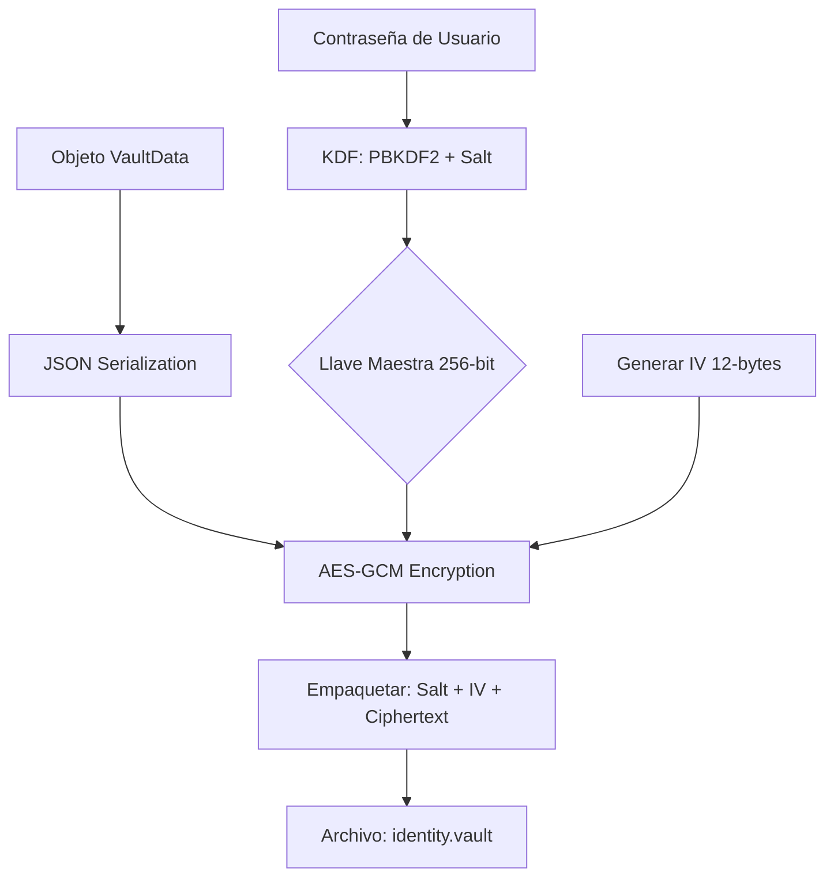
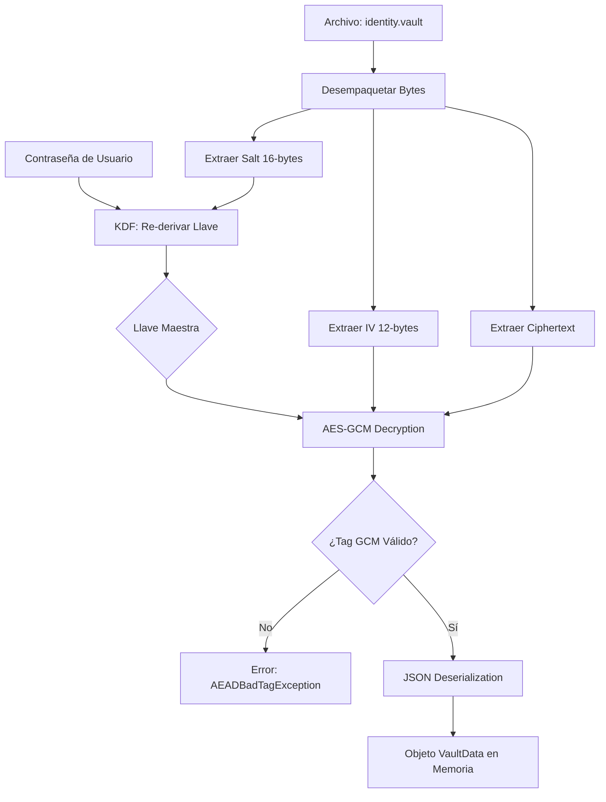

# Personal Data Vault: Informe Técnico de Arquitectura v1.0

## 1. Resumen Ejecutivo
Este proyecto es un MVP de una **Bóveda de Datos Soberana** construida sobre Java 17 y Quarkus. Su objetivo es permitir que los usuarios posean y protejan su identidad digital mediante cifrado de grado militar, eliminando la dependencia de servidores centrales.

---

## 2. Arquitectura de Seguridad (Implementada)

### A. Derivación de Clave (KDF)
Para transformar una contraseña humana en una llave criptográfica fuerte, implementamos **PBKDF2 with HMAC-SHA256**:
* **Iteraciones:** 600,000 (Cumple con los estándares OWASP 2026 para mitigar ataques de fuerza bruta por GPU).
* **Salt:** 16 bytes generados por `SecureRandom`. Se almacena en el header del archivo para permitir la reconstrucción de la llave en sesiones futuras.

### B. Algoritmo de Cifrado
Utilizamos **AES-256-GCM** (Advanced Encryption Standard en modo Galois/Counter Mode).
* **AEAD:** Este modo proporciona cifrado autenticado. Si un atacante modifica un solo bit del archivo `.vault`, el sistema detectará la alteración del *Authentication Tag* y rechazará el descifrado.
* **IV (Vector de Inicialización):** 12 bytes únicos por cada operación de escritura, evitando ataques de diccionario.

### C. Capa de Identidad Asimétrica (Ed25519)
* **Algoritmo:** Edwards-curve Digital Signature Algorithm (EdDSA) usando la curva Ed25519.
* **Derivación de DID:** El Identificador Descentralizado se genera siguiendo el método `did:key`, extrayendo la representación multibase de la llave pública.
* **Seguridad de la Llave Privada:** La llave privada se almacena codificada en Base64 dentro del payload cifrado con AES-GCM. Solo existe en texto plano en la memoria volátil (RAM) mientras la aplicación está activa.
---

## 3. Especificación del Formato de Archivo `.vault`

El archivo es un contenedor binario empaquetado mediante `ByteBuffer`. La estructura es la siguiente:

| Posición (Bytes) | Tamaño | Descripción | Estado    |
| :--- | :--- | :--- |:----------|
| `0 - 15` | 16 bytes | **Salt:** Para la derivación de clave. | Público   |
| `16 - 27` | 12 bytes | **IV (Nonce):** Valor aleatorio único por sesión. | Público   |
| `28 - Final` | Variable | **Ciphertext:** Datos JSON cifrados + Tag GCM. | Cifrado |

---

## 4. Diagramas de Flujo

### Proceso de Persistencia (Escritura)

### Proceso de Recuperación (Lectura)

---

## 5. Roadmap de Desarrollo (Fase 2)

### Identidad Soberana (DID)
El siguiente paso es la transición de una bóveda simétrica a una **Identidad Asimétrica**:
1.  **Generación de Semilla:** Derivar una semilla de 32 bytes a partir de la llave maestra.
2.  **Ed25519 KeyPair:** Generar un par de llaves (Pública/Privada) para firmas digitales.
3.  **DID Implementation:** Implementar el estándar `did:key` de la W3C.

### Conectores de Datos
* **Ingesta:** Adaptadores para extraer datos de GitHub y LinkedIn.
* **Normalización:** Conversión de perfiles sociales a esquemas de Identidad Digital.

---

## 6. Stack Tecnológico
* **Runtime:** Quarkus 3.x (Java 17).
* **CLI:** Picocli (Integración nativa).
* **Serialización:** Jackson (JSON-LD ready).
* **Criptografía:** JCE (Java Cryptography Architecture).

---

## 7. Capacidades de Firma Digital (Ed25519)

El sistema ahora soporta **Firmas Digitales de No-Repudio**.

### Flujo de Trabajo:
1. **Hash & Sign:** El mensaje se procesa mediante el algoritmo EdDSA.
2. **Determinismo:** Ed25519 es determinista, lo que elimina riesgos asociados con generadores de números aleatorios deficientes durante la firma.
3. **Verificación Independiente:** Cualquier entidad con acceso a la llave pública (extraída del DID) puede validar la autenticidad del mensaje mediante el estándar `X.509`.

> **Estado del MVP:** El núcleo criptográfico (Cifrado Simétrico) y el núcleo de Identidad (Firma Asimétrica) están integrados y validados.

---

## 8. Adaptadores de Datos Externos (Connectors)

### A. Adaptador GitHub
* **Tecnología:** MicroProfile REST Client (Reasteasy Reactive).
* **Flujo:** Consumo de API REST v3 de GitHub.
* **Mapeo:** Extracción de `login`, `bio`, y `public_repos`.
* **Seguridad:** Los datos externos se cifran inmediatamente al recibirse, minimizando la exposición de datos personales en texto plano en la memoria.

---

# Personal Data Vault: Especificación Técnica de Seguridad

## 1. Modelo de Criptografía Híbrida

### A. Capa Simétrica (Privacidad)
* **KDF:** PBKDF2 with HMAC-SHA256.
* **Fortalecimiento:** Se utiliza un **Secret Pepper** inyectado en tiempo de compilación. La fórmula de derivación es: `Key = PBKDF2(Password + Pepper, Salt)`.
* **Cifrado:** AES-256-GCM. Proporciona confidencialidad e integridad (AEAD). Cualquier manipulación del bitstream resulta en un fallo de autenticación inmediato.

### B. Capa Asimétrica (Identidad)
* **Algoritmo:** Ed25519 (EdDSA).
* **DID Method:** `did:key`.
* **Uso:** Firma de mensajes y generación de Credenciales Verificables (JSON-LD ready).

---

## 2. Registro de Auditoría e Integridad
El objeto `VaultData` incluye ahora un vector de auditoría (`accessLog`).
* **Propósito:** Detección de accesos no autorizados ("Evil Maid Attack").
* **Persistencia:** Solo se actualiza tras una validación exitosa del Tag GCM, asegurando que los logs no puedan ser inyectados externamente.

---

## 3. Patrones de Diseño y Arquitectura de Software

Para la transición a la App Móvil, el sistema adopta los siguientes patrones:

1.  **Hexagonal Architecture (Ports & Adapters):** Desacoplamiento total del motor criptográfico de la interfaz de usuario (CLI/Móvil).
2.  **Strategy Pattern:** Para permitir el cambio dinámico entre almacenamiento local (File System) y almacenamiento seguro de hardware (Keystore).
3.  **Singleton Scope:** El `SecurityService` garantiza que las llaves sensibles solo residan en un segmento controlado de la memoria RAM.

---

## 4. Estructura del Contenedor de Datos (`.vault`)

| Segmento | Longitud | Descripción |
| :--- | :--- | :--- |
| **Header: Salt** | 16 Bytes | Sal aleatoria para KDF. |
| **Header: IV** | 12 Bytes | Vector de inicialización para AES-GCM. |
| **Payload** | Variable | JSON cifrado (Incluye Identidad, Secretos y Auditoría). |
| **Tag GCM** | 16 Bytes | Firma de integridad del bloque cifrado. |

---
*Documento actualizado el 14 de Abril de 2026 para reflejar la implementación de Seguridad Proactiva, por el Ing. Jhon A. Garcia.*

*Documento generado el 09 de Abril de 2026 por el Ingeniero de Sistemas Jhon A. Garcia.*